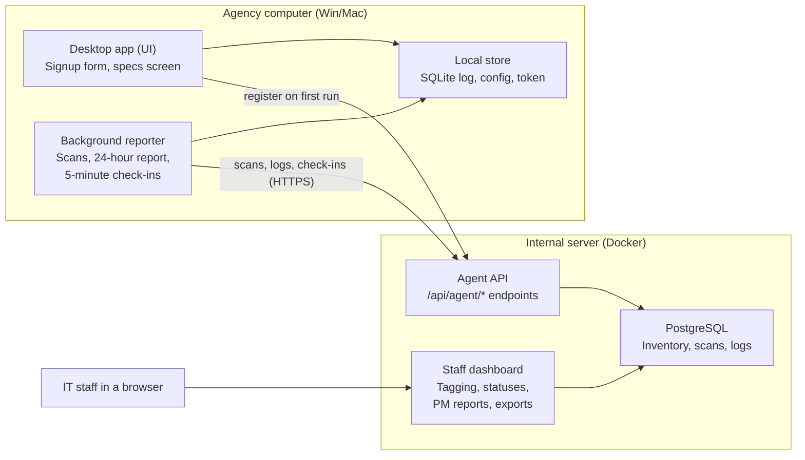

# Device Inventory & Tracking App — Technical Specification

Oct 16, 2026 · Programmer

This spec defines how the inventory system works; the project plan covers the build order.

## Goals and non-goals

The system must record who is assigned to each agency computer, what it contains, its condition, and its network health, with minimal manual work.

**Goals**

- Register each computer once, with the assigned user's details entered through a signup form.
- Collect hardware specs automatically on Windows and macOS and show them to the user.
- Tag system units and components with inventory numbers, individually or in a batch.
- Track assignment, grouping, and status history for every device and component.
- Log basic network status and app errors per device.
- Pre-fill Preventive Maintenance (PM) reports from a fresh on-demand scan.
- Present everything in a web dashboard with filters and exports.

**Non-goals**

- Continuous user activity monitoring (browsing, keystrokes, screenshots, location).
- Remote control, remote software installation, or remote wipe.
- Software license tracking (may be considered later).
- Public distribution or App Store release; the app is internal only.
- Linux support in the first version.

## Architecture

Computers only connect out; the server never reaches into user PCs.

The reporter and the desktop UI share a local store and send everything outbound over HTTPS, so user PCs need no open ports. Dashboard requests such as "scan now" wait on the server until the next check-in picks them up.

## Components

The system has four parts; the desktop UI and background reporter ship in one installer but run as separate processes.

| Component | Technology | Responsibilities |
| --- | --- | --- |
| Desktop app (UI) | Wails (Go + HTML/JS) | Signup form, specs summary screen, "update my details" screen, manual "report now" button |
| Background reporter | Go binary from the same codebase; Windows Service / macOS LaunchAgent | Hardware scan, network snapshot, local log storage, 24-hour report with catch-up at startup, check-ins for on-demand requests |
| Web app | Next.js (App Router) | Agent API (Route Handlers under `/api/agent/*`), staff dashboard, tagging, status changes, PM reports, exports |
| Database | PostgreSQL | Inventory records, history tables, raw scans as JSONB, device logs |

The UI and reporter share one local config and log store, so the reporter keeps working when nobody opens the app.

## Data model

Nine tables in PostgreSQL. Every table has `id` (UUID), `created_at`, and `updated_at`; history tables are append-only.

| Table | Key fields | Relationships |
| --- | --- | --- |
| `users` | full\_name, employee\_id, email, department, position, phone, policy\_acknowledged\_at | One user has many assignments |
| `devices` | device\_uuid (generated at install), inventory\_number, hostname, os\_type (windows / macos), device\_type, status, location, last\_seen\_at, last\_full\_scan\_at, token\_hash | Has many components, assignments, scans, logs, PM reports |
| `components` | device\_id, category (cpu, ram, storage, motherboard, gpu, nic, psu), manufacturer, model, serial\_number, capacity, inventory\_number (optional), is\_integrated, first\_seen\_at, removed\_at | Belongs to a device; `removed_at` set when a later scan no longer finds it |
| `assignments` | device\_id, user\_id, start\_at, end\_at, assigned\_by, notes | One open assignment (end\_at null) per device at a time |
| `status_history` | device\_id or component\_id, old\_status, new\_status, changed\_by, changed\_at, reason | Belongs to a device or a component |
| `scans` | device\_id, scan\_type (scheduled, startup, on\_demand, manual), collected\_at, received\_at, payload (JSONB), schema\_version | Belongs to a device; feeds component sync and PM diffs |
| `network_logs` | device\_id, collected\_at, ip\_addresses, mac\_addresses, gateway, dns\_servers, connection\_type, ssid (nullable), online | Belongs to a device |
| `device_logs` | device\_id, local\_entry\_id, logged\_at, level, category, message | Belongs to a device; unique on (device\_id, local\_entry\_id) to ignore duplicate uploads |
| `pm_reports` | device\_id, scan\_id, technician\_id, performed\_at, findings, actions\_taken, next\_due\_at | Belongs to a device and the scan it was based on |

**Rules**

- Statuses: In use, Spare, Under repair, For disposal, Disposed, Lost (see Open questions).
- Batch tagging sets one inventory number on the device and, optionally, numbered suffixes on its components (e.g. `AGY-2026-00123-C01`).
- On macOS, CPU, RAM, and storage on Apple Silicon are stored with `is_integrated = true` and cannot be tagged separately.
- Staff accounts for the dashboard live in separate `staff_*` tables managed by Better Auth, not in `users`. Staff sign in with their HRIS account (HRIS is the OIDC provider); only the HRIS user levels in `HRIS_ALLOWED_USER_LEVELS` (default `IT`) get a session. See README "Staff login (HRIS)".

## Scan field mapping

Both scanners produce the same JSON payload (`schema_version: 1`); fields a platform cannot supply are sent as `null`, never omitted. Windows reads WMI/CIM classes; macOS reads `system_profiler -json`, `sysctl`, and standard command-line tools.

| Category | Field | Windows source | macOS source | Notes |
| --- | --- | --- | --- | --- |
| System | Manufacturer, model | `Win32_ComputerSystem` | `SPHardwareDataType` | Mac manufacturer is always Apple |
| System | Serial number | `Win32_BIOS.SerialNumber` | `SPHardwareDataType.serial_number` | Some custom-built PCs report a placeholder |
| System | Hardware UUID | `Win32_ComputerSystemProduct.UUID` | `SPHardwareDataType.platform_UUID` | Supporting data only; the device ID is generated at install |
| System | Hostname | `Win32_ComputerSystem.Name` | `scutil --get ComputerName` |  |
| System | OS name, version, build | `Win32_OperatingSystem` | `sw_vers` |  |
| System | BIOS / firmware version | `Win32_BIOS.SMBIOSBIOSVersion` | `SPHardwareDataType` boot ROM version |  |
| CPU | Model, cores, threads, base speed | `Win32_Processor` | `sysctl machdep.cpu.brand_string`, `hw.physicalcpu`, `hw.logicalcpu`; chip name from `SPHardwareDataType` on Apple Silicon | Apple Silicon: integrated |
| RAM | Total memory | Sum of `Win32_PhysicalMemory.Capacity` | `sysctl hw.memsize` |  |
| RAM | Per-module slot, size, speed, part no., serial | `Win32_PhysicalMemory` | `SPMemoryDataType` (Intel Macs only) | Apple Silicon: total only, integrated |
| Storage | Model, serial, size, type (SSD/HDD), bus | `Win32_DiskDrive` + `MSFT_PhysicalDisk` | `SPStorageDataType`, `SPNVMeDataType`, `SPSerialATADataType` | Apple Silicon internal SSD: integrated |
| Storage | Free space per volume | `Win32_LogicalDisk.FreeSpace` | `df` on mounted volumes | Used for PM diffs and alerts |
| Motherboard | Manufacturer, product, serial | `Win32_BaseBoard` | Not available as a separate part | Mac: no motherboard component row |
| GPU | Name, memory, driver version | `Win32_VideoController` | `SPDisplaysDataType` |  |
| Network | Adapters: name, MAC, type | `Win32_NetworkAdapter` | `networksetup -listallhardwareports` |  |
| Network | IPs, gateway, DNS, DHCP | `Win32_NetworkAdapterConfiguration` | `ipconfig getifaddr`, `route get default`, `scutil --dns` |  |
| Network | Wi-Fi SSID | `netsh wlan show interfaces` | CoreWLAN | May require Location permission on recent Windows 11 and macOS; stored as `null` if hidden |
| Network | Server reachable | Check-in result | Check-in result | Recorded as `online` |

The exact WMI properties and `system_profiler` keys should be confirmed against a few real machines during the Windows and Mac builds.

## Agent API

All agent endpoints live under `/api/agent/`, accept and return JSON over HTTPS, and are separate from the dashboard's own routes. Every request except registration carries `Authorization: Bearer <device token>`.

| Method and path | Purpose | Request body | Success response |
| --- | --- | --- | --- |
| `POST /register` | First-time registration from the signup form | Enrollment key, device\_uuid, os\_type, hostname, hardware summary, user details | `201`: device\_id, device token (returned once), check-in interval |
| `PUT /user` | User updates their details | User details | `200` |
| `POST /scans` | Submit a full scan | scan\_uuid (generated on device), scan\_type, collected\_at, payload | `201`: scan\_id |
| `POST /logs` | Upload buffered log entries | Array of entries, each with local\_entry\_id, logged\_at, level, category, message | `200`: list of received local\_entry\_ids |
| `POST /checkin` | Routine check-in and network snapshot | Agent version, network snapshot, last\_full\_scan\_at | `200`: pending requests, next check-in interval |
| `POST /requests/{id}/complete` | Confirm a dashboard request was handled | Result (done or failed) and optional scan\_id | `200` |

**Pending request types** returned by `/checkin`: `scan_now` (for PM reports or a manual refresh), `send_logs`, and `prompt_details_update` (asks the user to confirm their details, e.g. after reassignment).

**Authentication**

- Registration requires an enrollment key that IT enters during install, so unknown machines cannot register themselves.
- The device token is a long random string. The server stores only its hash; the device stores it in the OS credential store (Windows Credential Manager, macOS Keychain).
- IT can revoke a token from the dashboard, which forces re-registration.

**Errors and retries**

| Code | Meaning | Agent behavior |
| --- | --- | --- |
| `400` | Invalid payload | Log an error; do not retry the same payload |
| `401` | Missing, invalid, or revoked token | Stop reporting; show "re-registration needed" in the app |
| `409` | Duplicate scan\_uuid | Treat as success |
| `413` | Payload too large | Split logs into smaller batches and retry |
| `429`, `5xx`, timeout | Server busy or unreachable | Retry with backoff: 1, 5, 15, then 60 minutes |

Duplicate uploads are safe: scans are deduplicated by scan\_uuid and logs by (device\_id, local\_entry\_id).

## Reporting and log behavior

The reporter sends a full report every 24 hours, catches up at startup when overdue, and checks in every 5 minutes for on-demand requests.

**Schedule**

1. At startup and once an hour, the reporter compares now with `last_confirmed_report_at`.
2. If 24 hours or more have passed, it runs a full scan, sends it to `/scans`, then uploads logs to `/logs`.
3. `last_confirmed_report_at` updates only after both calls succeed.
4. Separately, it calls `/checkin` every 5 minutes (server-adjustable) with a network snapshot and handles any pending requests.
5. A `scan_now` request triggers a full scan immediately, outside the 24-hour cycle, and is confirmed through `/requests/{id}/complete`.

**Local log**

- Stored in a local SQLite file in the app's data folder, shared by the UI and reporter.
- Each entry: `local_entry_id` (increasing number), `logged_at`, `level` (error, warning, info), `category` (scan, sync, signup, update, system), `message`.
- Info entries cover status updates such as "scan completed" or "details updated". Tokens and personal details are never logged.
- Cap: 5,000 entries. When full, the oldest entries are dropped and a warning entry records how many.

**Confirm-then-clear**

1. The reporter uploads entries in batches of up to 500.
2. The server responds with the `local_entry_id`s it stored.
3. The reporter deletes only those IDs; anything logged during the upload stays for the next cycle.
4. If the upload fails, nothing is deleted and the batch is retried on the next cycle.

## Security and access

The system holds personal details and a map of the agency's network, so it is treated as sensitive internal data.

**Transport and storage**

- HTTPS only, including on the internal network, using an internal CA certificate trusted by agency machines.
- Device tokens stored hashed on the server and in the OS credential store on devices.
- Database backups encrypted; the server reachable only from the agency network.

**Staff roles**

| Role | Can view | Can change |
| --- | --- | --- |
| Viewer | Devices, components, statuses, reports | Nothing |
| Technician | Everything a viewer sees, plus device logs and network logs | Request scans, write PM reports, change statuses |
| Inventory admin | Everything | Tagging, assignments, user records, exports |
| System admin | Everything | Staff accounts, enrollment keys, token revocation, retention settings |

**Auditing**

- All changes made in the dashboard (status, tagging, assignment, user edits) record the staff member and time.
- Staff logins and exports are logged.

**Privacy**

- Collection is limited to the fields in this spec; changes to collected data require updating the data-use notice.
- Users can view their own details and device specs in the desktop app.

## Non-functional requirements

Targets assume up to 1,000 devices; the actual count is an open question.

| Requirement | Target |
| --- | --- |
| Desktop installer size | Under 30 MB |
| Reporter idle footprint | Under 50 MB RAM; negligible CPU between scans |
| Full scan duration | Under 30 seconds on a typical machine |
| On-demand scan delay | Within 10 minutes of a dashboard request, if the device is online |
| Check-in interval | 5 minutes (adjustable from the server) |
| Stale device alert | No check-in for 48 hours |
| Dashboard page load | Under 2 seconds for lists of up to 1,000 devices |
| Retention: scans | Latest 30 per device, plus any scan linked to a PM report |
| Retention: network and device logs | 12 months |
| Retention: assignments, status history, PM reports | Kept permanently |
| Backups | Daily database backup, 30 days kept |
| Supported OS | Windows 10 and 11; macOS versions to be confirmed |

## Deployment and distribution

The web app and database run on one internal server; desktop installers are distributed by IT.

**Server**

- Docker Compose with two services: the Next.js app (`next start`) and PostgreSQL.
- A reverse proxy (e.g. Nginx or Caddy) in front for HTTPS.
- A scheduled job (cron) runs nightly for stale-device alerts, retention cleanup, and backups.

**Windows**

- An installer (MSI or NSIS) that installs the app, registers the background reporter, and prompts IT for the enrollment key.
- Unsigned builds may trigger a SmartScreen warning that IT clicks past on install.

**macOS**

- A `.pkg` or drag-to-Applications `.app` with a LaunchAgent for the reporter.
- Builds are unsigned and approved manually on each Mac through System Settings → Privacy & Security → Open Anyway. A one-page IT guide covers this and the Login Items check.
- Apple Silicon builds must carry at least an ad-hoc signature, which the build tools add by default.

**Updates**

- Updates are rare and installed manually by IT. The check-in reports the agent version, so the dashboard shows which machines run older versions.

## Open questions

- [ ] How many devices, and what Windows/Mac split, should the first version support?
- [ ] Which macOS versions must be supported?
- [ ] Is the status list final (In use, Spare, Under repair, For disposal, Disposed, Lost)?
- [ ] What is the inventory number format, and does the agency already have one?
- [ ] Who approves the data-use notice?
- [ ] Which signup fields are required versus optional?
- [ ] Does the agency already have an internal CA certificate for HTTPS?
- [ ] Should PM reports follow an existing agency form or template?
- [ ] Are the retention periods acceptable under agency records policy?
